# 🛡️ AI Security Intelligence Platform

### Hybrid AI-Powered Malicious URL Detection using Machine Learning, Rule-Based Analysis & Threat Intelligence

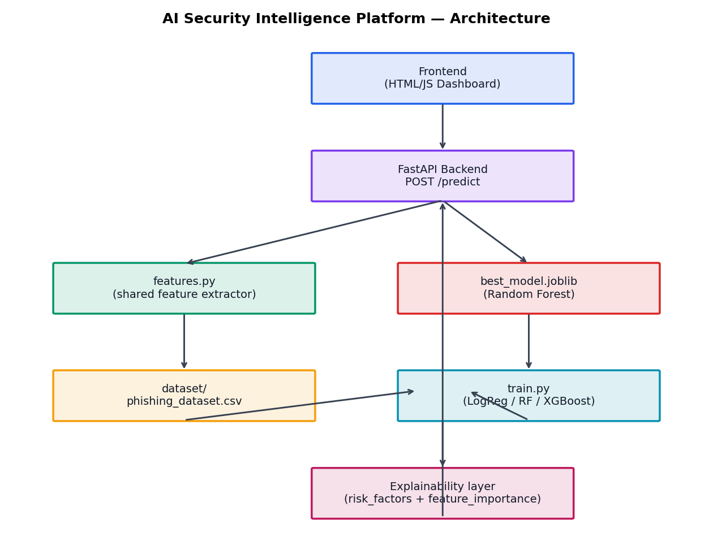

---

# 📌 Overview

The **AI Security Intelligence Platform** is a hybrid cybersecurity solution designed to detect and analyze malicious URLs using a multi-layered security approach. Instead of relying solely on Machine Learning, the platform combines **Feature Engineering**, **Rule-Based Detection**, **Domain Intelligence**, **Threat Intelligence**, and an **AI Security Agent** to provide accurate predictions together with explainable security insights.

The system classifies URLs into three categories:

- 🟢 Safe
- 🟡 Suspicious
- 🔴 Malicious

Each submitted URL undergoes multiple security checks, including feature extraction, phishing pattern detection, domain validation, machine learning prediction, and optional VirusTotal verification. The final output includes the predicted class, confidence score, risk level, detected risk factors, domain information, and a human-readable security explanation.

This project demonstrates the practical implementation of **Machine Learning**, **FastAPI**, **Cybersecurity**, **Threat Intelligence**, and **Explainable AI** in a real-world malicious URL detection system.

---

# 🎯 Project Objectives

The primary objective of this project is to develop a hybrid AI-powered cybersecurity platform capable of identifying malicious URLs with improved accuracy and transparency.

The platform aims to:

- Detect whether a URL is **Safe**, **Suspicious**, or **Malicious**.
- Extract meaningful security-related features from URLs.
- Compare multiple Machine Learning models.
- Improve prediction accuracy using rule-based phishing detection.
- Perform domain validation using DNS, WHOIS, and RDAP.
- Integrate VirusTotal for external threat intelligence.
- Generate human-readable explanations using an AI Security Agent.
- Provide an interactive dashboard for real-time URL analysis.

---

# ✨ Key Features

## 🔍 URL Security Analysis

- Real-time URL analysis
- Safe, Suspicious, and Malicious classification
- Confidence score calculation
- Risk level assessment

## 🤖 Machine Learning

- Logistic Regression
- Random Forest
- XGBoost
- Multi-model comparison
- Automatic best model selection

## 🛡 Rule-Based Detection

- Suspicious keyword detection
- Typosquatting detection
- Suspicious TLD detection
- IP address detection
- URL shortener detection
- Rule-based prediction override

## 🌐 Domain Intelligence

- DNS Resolution
- Domain Availability
- WHOIS Lookup
- RDAP Lookup
- Domain Age Analysis

## ⚡ Threat Intelligence

- VirusTotal Integration
- Detection Ratio
- Reputation Analysis
- External Threat Verification

## 💬 AI Security Agent

- Human-readable explanations
- Security recommendations
- Risk factor analysis
- Explainable AI

## 📊 Dashboard

- Interactive web interface
- Model selection
- AI Agent toggle
- Threat Intelligence toggle
- Risk visualization
- Prediction summary

## 🚀 Backend API

- FastAPI
- REST API
- JSON Responses
- Swagger Documentation

---

# 🏗️ System Architecture

The AI Security Intelligence Platform follows a layered architecture where every submitted URL passes through multiple security stages before generating the final prediction.

The system combines Feature Engineering, Machine Learning, Rule-Based Detection, Domain Intelligence, Threat Intelligence, and an AI Security Agent to produce a comprehensive security assessment.


### Architecture Workflow

1. User submits a URL through the dashboard.
2. FastAPI receives the request.
3. Security-related features are extracted from the URL.
4. The selected Machine Learning model predicts the URL category.
5. Rule-Based Detection checks for known phishing patterns.
6. Domain Intelligence validates domain information.
7. VirusTotal Threat Intelligence performs external verification (optional).
8. AI Security Agent generates a human-readable explanation.
9. The backend returns the final security report to the dashboard.

---
# 📂 Project Structure

```text
project/
│
├── backend/
│   ├── main.py
│   ├── features.py
│   ├── requirements.txt
│   └── .env
│
├── frontend/
│   └── index.html
│
├── model/
│   ├── train.py
│   ├── features.py
│   ├── best_model.joblib
│   ├── model_LogisticRegression.joblib
│   ├── model_RandomForest.joblib
│   ├── model_XGBoost.joblib
│   ├── label_encoder.joblib
│   ├── metrics.json
│   ├── feature_importance.png
│   ├── model_comparison.png
│   └── confusion_matrix_*.png
│
├── dataset/
│   ├── phishing_dataset.csv
│   └── generate_dataset.py
│
├── notebooks/
│   ├── eda.py
│   └── feature_distributions.png
│
├── screenshots/
│   ├── 1-dashboard.png
│   ├── 2-safe-url.png
│   ├── 3-malicious-url.png
│   ├── 4-model-comparison.png
│   ├── 5-ai-agent.png
│   ├── 6-threat-intelligence.png
│   ├── 7-domain-age.png
│   ├── 8-api-docs.png
│   ├── 9-feature-importance.png
│   └── 10-confusion-matrix.png
│
├── architecture.png
├── Dockerfile
├── README.md
└── .gitignore
```

---

# 📁 Folder Description

| Folder | Purpose |
|---------|----------|
| **backend/** | FastAPI backend responsible for URL analysis, Machine Learning prediction, Domain Intelligence, AI Agent, and Threat Intelligence. |
| **frontend/** | Interactive dashboard built using HTML, CSS, and JavaScript. |
| **model/** | Training pipeline, trained models, evaluation metrics, feature importance, and comparison graphs. |
| **dataset/** | Dataset used for training and testing the Machine Learning models. |
| **notebooks/** | Exploratory Data Analysis (EDA) scripts and dataset visualization. |
| **screenshots/** | Images used in the project documentation and README. |
| **architecture.png** | High-level architecture diagram of the platform. |
| **Dockerfile** | Docker configuration for deployment. |
| **README.md** | Complete project documentation. |

---

# 📊 Dataset Preparation

The platform is trained using a phishing URL dataset containing three different security categories.

| Class | Description |
|--------|-------------|
| 🟢 Safe | Legitimate and trusted websites |
| 🟡 Suspicious | URLs that exhibit suspicious characteristics |
| 🔴 Malicious | Confirmed phishing, scam, or harmful websites |

The dataset is stored in:

```text
dataset/phishing_dataset.csv
```

---

## Data Preprocessing

Before training the Machine Learning models, the dataset was cleaned and preprocessed to improve data quality.

The preprocessing pipeline includes:

- Removing duplicate URLs
- Removing missing values
- Standardizing URL format
- Label Encoding
- Feature Extraction
- Train/Test Split

These preprocessing steps ensure that the models are trained using clean and consistent data.

---

# 🔍 Feature Engineering

Instead of training directly on raw URLs, the platform extracts meaningful cybersecurity features that represent the structure and behaviour of each URL.

A total of **17 security-related features** are extracted before prediction.

## URL Features

- URL Length
- Number of Dots
- Number of Hyphens
- Number of Special Characters
- HTTPS Detection
- @ Symbol Detection
- Digit Ratio
- URL Path Length

---

## Domain Features

- Domain Length
- Number of Subdomains
- Suspicious Top-Level Domain (TLD)
- Domain Age
- DNS Resolution

---

## Security Features

- Suspicious Keyword Detection
- IP Address Detection
- URL Shortener Detection
- Redirect Count
- Shannon Entropy

These handcrafted features enable the Machine Learning models to identify phishing patterns instead of memorizing URLs, allowing the platform to generalize better to previously unseen malicious websites.

---

# 🤖 Machine Learning Models

The platform supports multiple supervised Machine Learning algorithms for URL classification.

## Logistic Regression

Used as the baseline model due to its simplicity, fast prediction speed, and interpretability.

---

## Random Forest

An ensemble learning algorithm that combines multiple decision trees to improve prediction accuracy while reducing overfitting.

---

## XGBoost

A powerful gradient boosting algorithm capable of learning complex phishing patterns and providing high predictive performance.

---

## Training Pipeline

The complete Machine Learning pipeline consists of the following steps:

1. Load the dataset.
2. Clean and preprocess the data.
3. Extract security-related features.
4. Encode target labels.
5. Split data into training and testing sets.
6. Train all three Machine Learning models.
7. Evaluate model performance.
8. Select the best model using **Macro F1 Score**.
9. Save trained models for deployment.

---

## Evaluation Metrics

Each Machine Learning model is evaluated using:

- Accuracy
- Precision
- Recall
- Macro F1 Score
- Confusion Matrix

The best-performing model is automatically exported as:

```text
best_model.joblib
```

The remaining trained models are also saved for comparison and experimentation.

---
# 📈 Model Evaluation & Results

To ensure reliable performance, all Machine Learning models were evaluated using multiple classification metrics instead of relying only on accuracy.

The following evaluation metrics were used:

- Accuracy
- Precision
- Recall
- Macro F1 Score
- Confusion Matrix

The best-performing model was automatically selected using the **Macro F1 Score** and exported for deployment.

---

## 📊 Model Comparison

The platform compares the performance of Logistic Regression, Random Forest, and XGBoost to identify the most suitable model for malicious URL detection.

The comparison includes Accuracy, Precision, Recall, and Macro F1 Score.

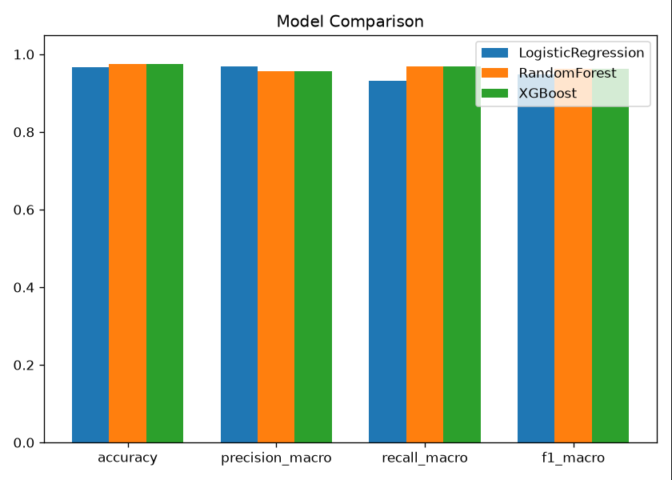

---

## 📈 Feature Importance

Feature Importance analysis helps identify which security-related features contribute the most to the prediction process.

Understanding feature importance improves model interpretability and provides insights into phishing detection patterns.

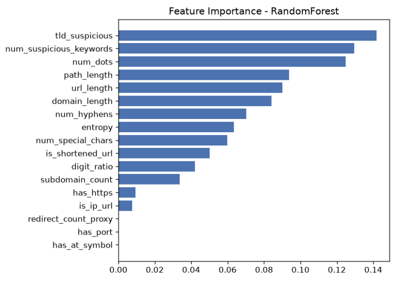

---

## 🎯 Confusion Matrix

The Confusion Matrix provides a detailed visualization of the model's classification performance across all three classes.

It illustrates how accurately the model distinguishes between:

- Safe URLs
- Suspicious URLs
- Malicious URLs

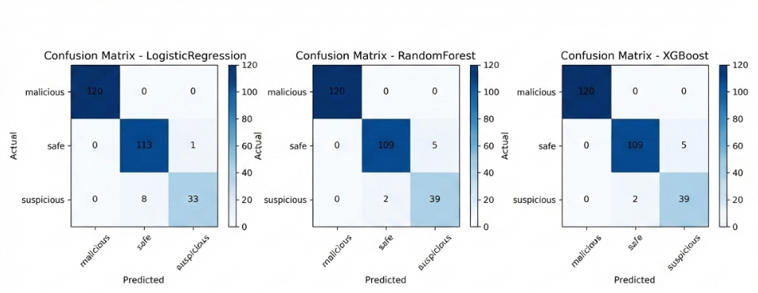

---

# 🤖 AI Security Agent

The platform includes an AI Security Agent that generates human-readable explanations for every prediction.

Instead of displaying only the predicted class, the AI Agent explains why the URL is considered Safe, Suspicious, or Malicious.

The explanation includes:

- Prediction summary
- Risk assessment
- Domain validation
- HTTPS status
- Suspicious keyword detection
- Security recommendations

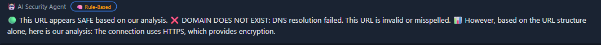

---

# 🌐 Threat Intelligence

To improve detection reliability, the platform integrates VirusTotal Threat Intelligence.

This module compares the Machine Learning prediction with external threat intelligence collected from multiple security vendors.

The Threat Intelligence report includes:

- Detection Ratio
- Reputation Score
- Malicious Detections
- Suspicious Detections
- External Threat Verification

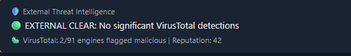

---

# 🌍 Domain Intelligence

The platform performs domain validation before generating the final prediction.

The Domain Intelligence module performs:

- DNS Resolution
- Domain Availability Check
- WHOIS Lookup
- RDAP Lookup
- Domain Age Analysis

This information helps identify newly registered phishing domains and suspicious websites.

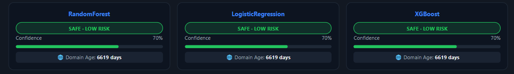

---

# 📚 API Documentation

The backend is developed using **FastAPI** and provides interactive API documentation using **Swagger UI**.

Developers can easily test endpoints, inspect request formats, and verify responses directly from the browser.

Main Endpoint:

```http
POST /predict
```

The API returns:

- Prediction
- Confidence Score
- Risk Level
- Feature Summary
- Domain Information
- AI Explanation
- Threat Intelligence Results

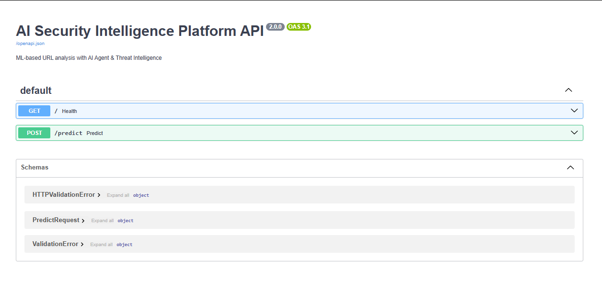

---
# ⚙️ Installation

## Prerequisites

Before running the project, make sure the following software is installed:

- Python 3.10 or later
- Git
- FastAPI
- Uvicorn
- pip

---

## Clone the Repository

```bash
git clone https://github.com/your-username/ai-security-intelligence-platform.git

cd ai-security-intelligence-platform
```

---

## Install Dependencies

```bash
pip install -r requirements.txt
```

---

## Configure Environment Variables

Create a `.env` file inside the `backend/` directory.

Example:

```env
VIRUSTOTAL_API_KEY=YOUR_API_KEY
OPENAI_API_KEY=YOUR_API_KEY
```

---

# 🚀 Running the Project

## Start the Backend

```bash
cd backend

uvicorn main:app --reload --port 8000
```

Backend will be available at:

```
http://127.0.0.1:8000
```

Swagger Documentation:

```
http://127.0.0.1:8000/docs
```

---

## Start the Frontend

```bash
cd frontend

python -m http.server 3000
```

Open the dashboard in your browser:

```
http://127.0.0.1:3000
```

---

# 📡 API Usage

## Request

```http
POST /predict
```

Example JSON Request

```json
{
    "url": "https://secure-paypal-login-example.com",
    "model_name": "RandomForest",
    "use_ai_agent": true,
    "use_threat_intel": true
}
```

---

## Example Response

```json
{
    "prediction": "Malicious",
    "confidence": 98.7,
    "risk_level": "High",
    "domain_exists": true,
    "domain_age": "45 Days",
    "risk_factors": [
        "Suspicious Keywords",
        "Suspicious TLD",
        "High URL Entropy"
    ]
}
```

---

# 📷 Project Screenshots

## Dashboard

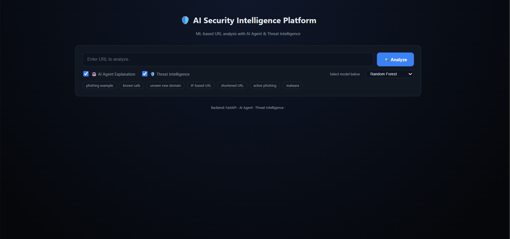

---

## Safe URL Detection

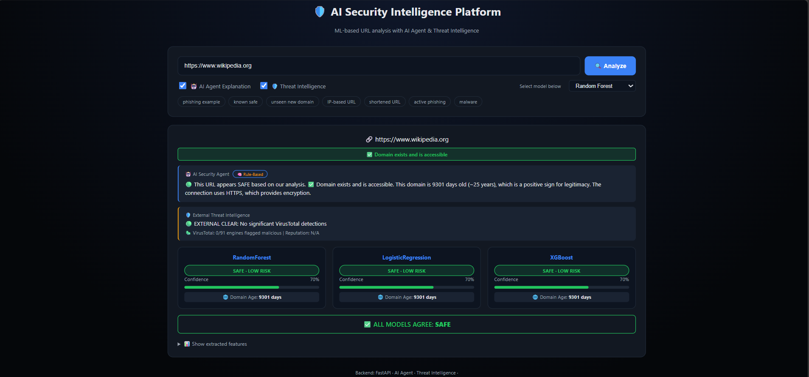

---

## Malicious URL Detection

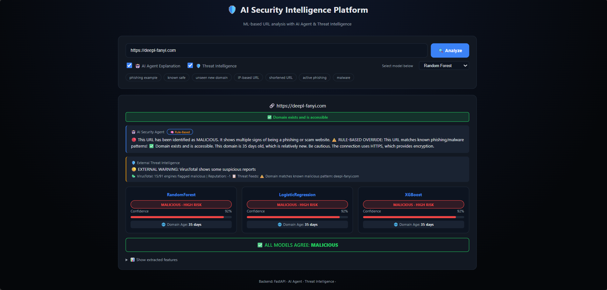

---

## AI Security Agent


---

## Threat Intelligence


---

## Domain Intelligence


---

## Swagger API


---

# 🔮 Future Improvements

Future versions of the platform may include:

- Browser Extension
- Google Safe Browsing API Integration
- Deep Learning Models
- QR Code Security Analysis
- Email Phishing Detection
- Real-Time Threat Feed
- User Authentication
- Dashboard Analytics
- Cloud Deployment

---

# 👨‍💻 Author

**Muhammad Muazan Abdullah**


AI • Machine Learning • FastAPI • Cybersecurity

GitHub: https://github.com/muazan710

---


# ⭐ Acknowledgements

Special thanks to the open-source community and the developers of:

- FastAPI
- Scikit-learn
- XGBoost
- VirusTotal
- Python

Their tools and libraries made this project possible.